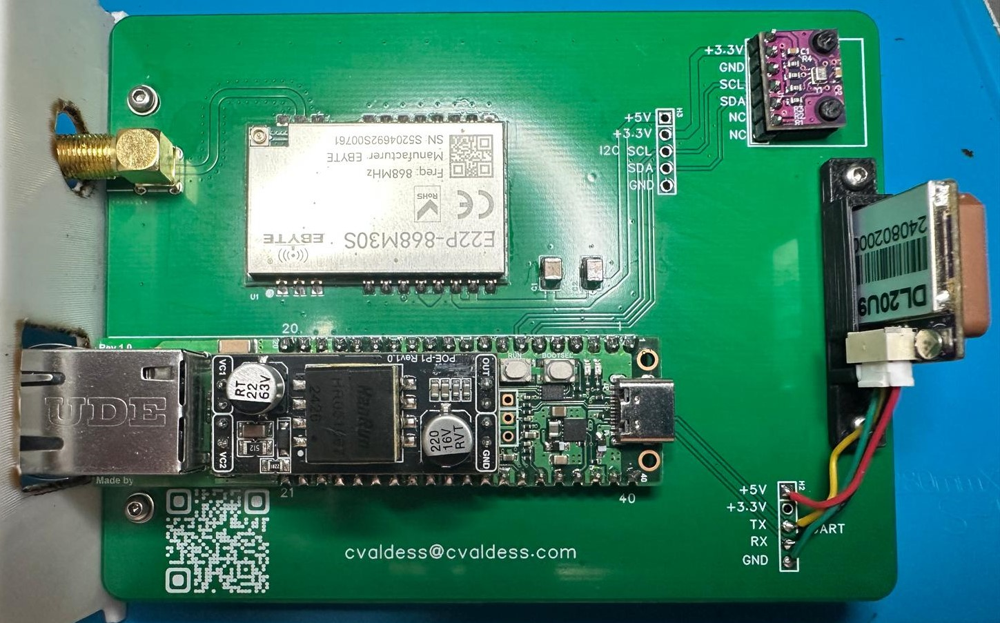
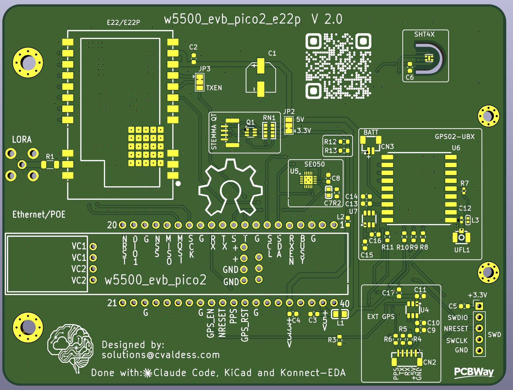
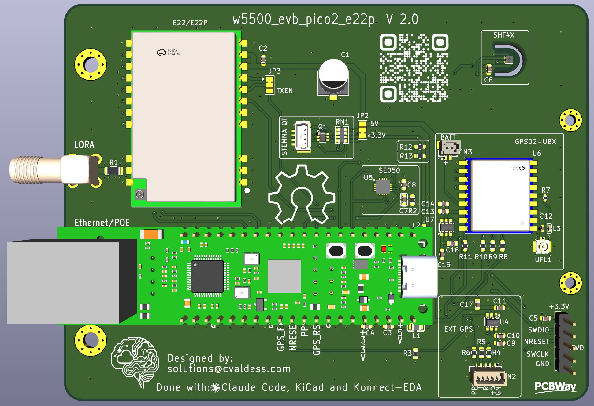
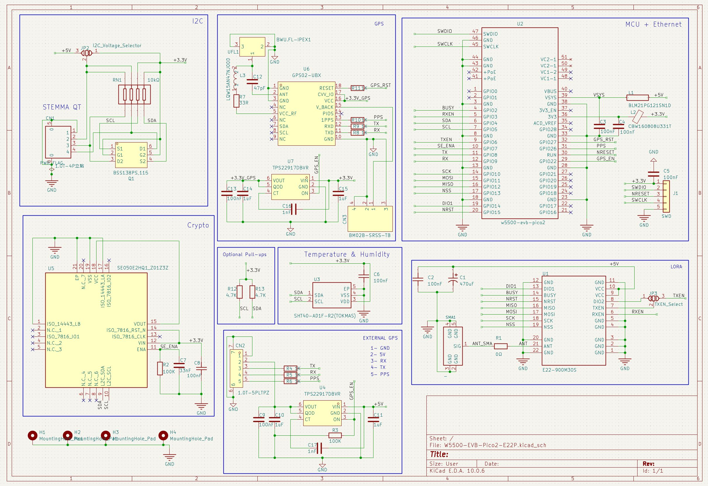

# Wiznet_5500_EVB_Pico2_E22P

A custom PCB carrier board built around the **WIZnet W5500-EVB-Pico2** (an RP2350 with an **on-board W5500 Ethernet** controller) and an **Ebyte E22P LoRa module**, in a single compact design for Meshtastic applications, low-cost Ethernet MQTT Gateway, APRS iGate/Digipeater and Reticulum transport node.

*Previous revision, assembled. The V2.0 boards are on their way from the fab; photos will follow.*

Everything needed to build this board yourself is in this repository, under the GPL: the schematic,
the Gerbers, the main components and the pin mapping.

> Meshtastic is a trademark of Meshtastic LLC. This board is an independent design, not
> affiliated with or endorsed by Meshtastic LLC.

## License

This project is licensed under the [GNU General Public License v2.0](LICENSE).

## Author

**@cvaldess** — [cvaldess@cvaldess.com](mailto:cvaldess@cvaldess.com) - [meshtastic.cvaldess.com](https://meshtastic.cvaldess.com)

## PCB V2.0

## Features

- **WIZnet W5500-EVB-Pico2** — RP2350-based microcontroller with dual-core Arm Cortex-M33 / RISC-V and an **on-board W5500** hardwired TCP/IP Ethernet controller (no external SPI Ethernet module required)
- **WIZPoE-P1** - Compact PoE module compliant with IEEE802.3af, supporting Mode A and Mode B
- **Ebyte E22P (868M30S)** — LoRa transceiver module (868 MHz, 30 dBm) for long-range wireless communication. The 433 MHz E22P-433M30S fits the same footprint (LoRa APRS)
- **SHT4X** — SHT4X Sensirion Temperature/Humidity sensors via I2C
- **I2C expansion header** (STEMMA QT) for I2C Sensors (Optional)
- **GPS expansion header** +5V, TX, RX, PPS, GND for external GPS module (Optional)
- **GPS02-UBX** Quad-Mode Satellite UBLOX GPS Module With Latest UBLOX IC M10 Series And ESD Protection (Optional)
- **SE050** NXP Semiconductors EdgeLock SE050 Plug and Trust Secure Element (Optional)
- **PoE PD** - Power Supply.

## Board Images

| 3D Render V2.0 | Assembled (previous revision) |
|:---------:|:---------:|
|  |  |

## Schematic

The full V2.0 schematic is available as a JPG file:

## Bill of Materials

| Component | Description | Quantity |
|-----------|-------------|:--------:|
| [WIZnet W5500-EVB-Pico2](https://shop.wiznet.eu/en/w5500-evb-pico2.html) | RP2350 microcontroller board with on-board W5500 Ethernet | 1 |
| [WIZPoE-P1](https://shop.wiznet.eu/en/wizpoe-p1.html) | Compact PoE module compliant with IEEE802.3af, supporting Mode A and Mode B | 1 |
| [Ebyte E22P-868M30S](https://s.click.aliexpress.com/e/_c3ABeS7X) | SX1262 Wireless Transceiver LoRa Module (30 dBm) | 1 |
| [PoE Injector 802.3af](https://s.click.aliexpress.com/e/_c3LHjvOt) | 802.3af PoE Injector | 1 |

## Pin Mapping

### W5500 Ethernet (SPI0) — on-board

| W5500 Pin | Pico 2 GPIO |
|-----------|-------------|
| MISO      | GP16        |
| CS        | GP17        |
| SCK       | GP18        |
| MOSI      | GP19        |
| RST       | GP20        |

### Ebyte E22P LoRa (SPI1)

| E22P Pin | Pico 2 GPIO |
|----------|-------------|
| SCK      | GP10        |
| MOSI     | GP11        |
| MISO     | GP12        |
| CS       | GP13        |
| RST      | GP15        |
| DIO1/IRQ | GP14        |
| BUSY     | GP2         |
| RXEN     | GP3 (held HIGH — LNA/PA enable) |
| TXEN     | DIO2 through JP3 (default), or GP6 |

JP3 (TXEN select, solder jumper): bridged 1-2 by default, so DIO2 drives the E22P's TXEN. Cut it and
bridge 2-3 to drive TXEN from GP6 instead (not tested yet).

### Other GPIOs (V2.0)

| Signal | Pico 2 GPIO | Notes |
|--------|-------------|-------|
| I2C SDA | GP4 | SHT4x, SE050 and CN1 (level-shifted) |
| I2C SCL | GP5 | |
| SE050 enable | GP7 | |
| GPS TX (MCU → GPS) | GP8 | UART1 |
| GPS RX (GPS → MCU) | GP9 | UART1 |
| GPS PPS | GP26 | not tested yet |
| GPS power enable | GP22 | TPS22917 load switch: the GPS has no power until GP22 is driven high |
| GPS reset | GP27 | on-board GPS02-UBX only |
| E22P TXEN (alternative) | GP6 | only with JP3 bridged 2-3 |

### I2C Expansion (STEMMA QT) — CN1

| Pin | Signal |
|-----|--------|
| 1   | GND    |
| 2   | VCC    |
| 3   | SDA    |
| 4   | SCL    |

JP2 (CN1 VCC select, solder jumper): 3.3 V by default (bridged 1-2), or 5 V (bridged 2-3).

### GPS Expansion (JST SH 1.00 mm) — CN2

| Pin | Signal |
|-----|--------|
| 1   | GND    |
| 2   | 5V VCC |
| 3   | TX     |
| 4   | RX     |
| 5   | PPS    |

## Meshtastic Firmware

Pre-built Meshtastic firmware (v2.8.X) for the WIZnet W5500-EVB-Pico2 + E22P hardware. This version includes the "Use with client.meshtastic.org" feature. Choose your installation method:

### Method 1: Direct USB flash (UF2)
Hold the BOOTSEL button while connecting the board via USB, then drag-and-drop the UF2 file onto the RP2350 drive that appears.

- [Download .uf2 file](https://meshfiles.cvaldess.com/firmware-wiznet_5500_evb_pico2_e22p.uf2)

### Method 2: Ethernet OTA utility
Update an already-deployed node over the network using the [Ethernet OTA utility](https://github.com/meshtastic/firmware/pull/10136). Download the BIN file and upload it through the utility.

- [Download .bin file](https://meshfiles.cvaldess.com/firmware-wiznet_5500_evb_pico2_e22p.bin)

### Method 3: Client Area
In the Client Area you can flash and configure it easily, and protect your image with a custom PSK.

 - [Client Area](https://clientarea.cvaldess.com/)

## CA2RXU LoRa APRS iGate/Digipeater firmware

Pre-built CA2RXU LoRa APRS iGate/Digipeater firmware for this board with the 433 MHz E22P-433M30S, on either
the WIZnet W5500-EVB-Pico2 or the W5100S-EVB-Pico2. The RP2350 + Ethernet port is pending upstream review
([richonguzman/LoRa_APRS_iGate#438](https://github.com/richonguzman/LoRa_APRS_iGate/pull/438)).

### Method 1: Direct USB flash (UF2)
Hold the BOOTSEL button while connecting the board via USB, then drag-and-drop the UF2 file onto the RP2350 drive that appears.

- W5500-EVB-Pico2: [Download .uf2 file](https://meshfiles.cvaldess.com/igate-wiznet_5500_evb_pico2_e22p-1009.uf2)
- W5100S-EVB-Pico2: [Download .uf2 file](https://meshfiles.cvaldess.com/igate-wiznet_5100s_evb_pico2_e22p-1009.uf2)

### Method 2: Ethernet OTA
Update an already-deployed node over the network from the node's web OTA page.

- W5500-EVB-Pico2: [Download .bin file](https://meshfiles.cvaldess.com/igate-wiznet_5500_evb_pico2_e22p-1009.bin)
- W5100S-EVB-Pico2: [Download .bin file](https://meshfiles.cvaldess.com/igate-wiznet_5100s_evb_pico2_e22p-1009.bin)

## Use Cases
- Meshtastic mesh network
- Low cost MQTT Gateway
- APRS iGate/Digipeater
- Reticulum Transport Node
- Remote environmental monitoring (temperature, pressure)
- LoRa-based sensor networks with Ethernet gateway
- Industrial IoT data collection nodes
- Weather station with wired and wireless connectivity
